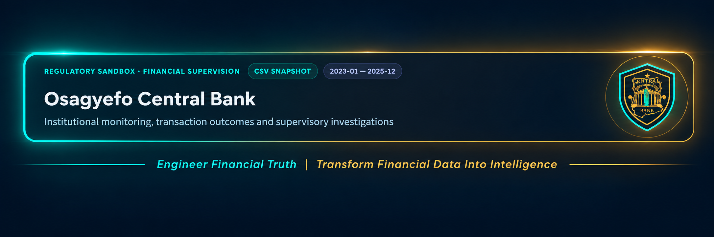
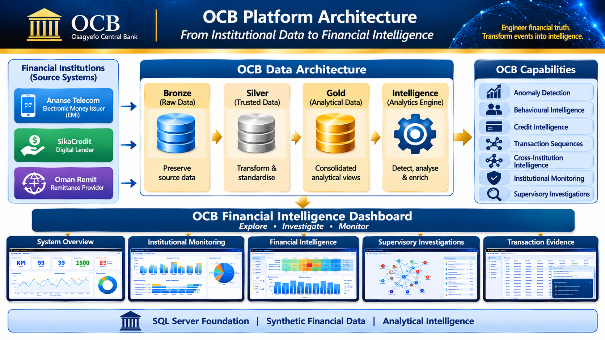

  

<h1 align="center">OSAGYEFO CENTRAL BANK (OCB)</h1>

<h3 align="center">Digital Financial Intelligence Platform</h3>

  Engineer financial truth. Transform events into intelligence.

---

## 1. PROJECT OVERVIEW

The **Osagyefo Central Bank (OCB) Digital Financial Intelligence Platform** is a SQL-first financial intelligence and supervisory monitoring project designed to demonstrate how financial data from interconnected institutions can be transformed into structured intelligence.

Built as a synthetic regulatory sandbox, OCB models the financial activities of three independent institutions operating across different segments of the digital financial ecosystem. It integrates their data, establishes cross-institution customer identity relationships, and applies analytical intelligence to identify unusual financial activity, behavioural patterns, institutional risks, and interconnected financial relationships.

The platform combines data engineering, financial behaviour analysis, anomaly detection, cross-institution intelligence, institutional monitoring, and supervisory investigations within a unified analytical environment.

**OCB Platform v1.0.0** establishes the foundational architecture and analytical capabilities of this environment.

## 2. PLATFORM ARCHITECTURE

OCB follows a layered data architecture that transforms institutional source data into analytical and supervisory intelligence.

  

| Layer | Responsibility |
|---|---|
| **Bronze** | Preserves institutional source data in its original structural form. |
| **Silver** | Applies data transformations, standardisation, validation, and cross-institution customer identity resolution. |
| **Gold** | Provides consolidated analytical views across transactions, customers, loans, repayments, remittances, and institutions. |
| **Intelligence** | Implements SQL-based analytical engines for anomaly detection, behavioural analysis, transaction sequences, and cross-institution intelligence. |
| **Monitoring & Investigations** | Supports institutional monitoring and supervisory examination through structured intelligence outputs. |
| **Dashboard** | Presents analytical results through an interactive financial intelligence interface. |

The architecture maintains a separation between institutional source data, transformed analytical data, and intelligence outputs.

SQL Server serves as the platform's analytical foundation and source of truth.

## 3. INSTITUTIONAL COVERAGE

The platform models three independent financial institutions:

| Institution | Institutional Profile | Primary Activities |
|---|---|---|
| **Ananse Telecom** | Electronic Money Issuer (EMI) | Mobile money transactions, cash-in, cash-out, P2P transfers, and merchant payments. |
| **SikaCredit** | Digital Lender | Loan disbursements, repayment activity, and credit behaviour. |
| **Oman Remit** | Remittance Provider | Inbound and outbound remittance transactions. |

Each institution operates within its own simulated institutional boundary. Cross-institution intelligence is developed through resolved customer relationships and analytical connections rather than shared operational infrastructure.

## 4. FINANCIAL INTELLIGENCE CAPABILITIES

OCB v1.0.0 incorporates several analytical engines designed to examine financial activity from different perspectives.

### Transaction Anomaly Detection
Examines transaction-level activity to identify unusual patterns, deviations, and potentially suspicious financial behaviour.

### Behavioural Intelligence
Analyses customer transaction behaviour, including activity patterns, frequency, value, and changes in behavioural characteristics.

### Credit Behaviour Intelligence
Examines lending and repayment behaviour to identify unusual credit activity and potentially significant repayment patterns.

### Transaction Sequence Intelligence
Evaluates the temporal and structural relationships between financial events, identifying unusual sequences and patterns that may not be apparent from isolated transactions.

### Cross-Institution Intelligence
Examines financial relationships and activity across institutional boundaries to identify interconnected behaviours, unusual relationships, and potential risks involving multiple institutions.

### Institutional Monitoring
Provides institution-level monitoring of financial activity, operational patterns, and selected institutional indicators.

### Supervisory Intelligence
Combines analytical outputs to support structured supervisory investigations into financial behaviour, institutional activity, and cross-institution relationships.

## 5. INTERACTIVE FINANCIAL INTELLIGENCE DASHBOARD

The OCB Financial Intelligence Dashboard provides an interactive presentation layer for exploring the platform's analytical outputs.

It is designed to make financial intelligence accessible through institutional monitoring, analytical summaries, investigation views, and transaction-level evidence.

**The dashboard supports two data access modes:**

- **SQL Mode:** Retrieves analytical results from the deployed OCB SQL Server environment.
- **CSV Mode:** Uses prepared public data snapshots, allowing the dashboard to operate independently of a live SQL Server connection.

The public dashboard is deployed through Streamlit Community Cloud.

  <a href="https://ocb-financial-intelligence.streamlit.app/"><strong>OPEN THE LIVE OCB FINANCIAL INTELLIGENCE DASHBOARD →</strong></a>

### Dashboard Preview

#### System Overview
<!-- Screenshot: Overall platform metrics and system-level activity -->

  

#### Institutional Monitoring
<!-- Screenshot: Institutional activity and monitoring indicators -->

  

#### Financial Intelligence
<!-- Screenshot: Financial intelligence and analytical engine outputs -->

  

#### Supervisory Investigations
<!-- Screenshot: Supervisory investigation interface and findings -->

  

#### Transaction Evidence
<!-- Screenshot: Transaction-level evidence supporting analytical findings -->

  

## 6. TECHNOLOGY STACK

| Technology | Application |
|---|---|
| **Microsoft SQL Server** | Relational data storage, transformation, analytical modelling, and intelligence engines. |
| **T-SQL** | Data processing, identity resolution, analytical views, anomaly detection, and supervisory investigations. |
| **Python** | Dashboard development, data snapshot preparation, and supporting automation. |
| **Streamlit** | Interactive financial intelligence dashboard. |
| **Pandas** | Data preparation and manipulation. |
| **Git & GitHub** | Version control and project repository management. |

## 7. DATA AND SIMULATION DISCLAIMER

OCB is an independent analytical project built using synthetic financial data.

The institutions, customers, transactions, loans, remittances, and associated financial activities represented within the platform are simulated. They do not constitute actual financial records or represent the operational systems of any real financial institution.

The platform is intended for demonstration, analytical exploration, and the development of financial intelligence and supervisory monitoring concepts. It is not a production regulatory system or a substitute for formal supervisory processes.

## 8. EXECUTION AND PROJECT DOCUMENTATION

The repository contains the SQL scripts, synthetic source data, supporting documentation, and dashboard components required to examine and execute the platform.

For deployment and execution instructions, see the **[Execution Guide](execution.md)**.

For the platform's current capabilities and longer-term development direction, see **[OCB Project Future](OCB_PROJECT_FUTURE.md)**.

---

  <strong>OCB PLATFORM v1.0.0</strong> 
  Engineer financial truth. Transform events into intelligence.

